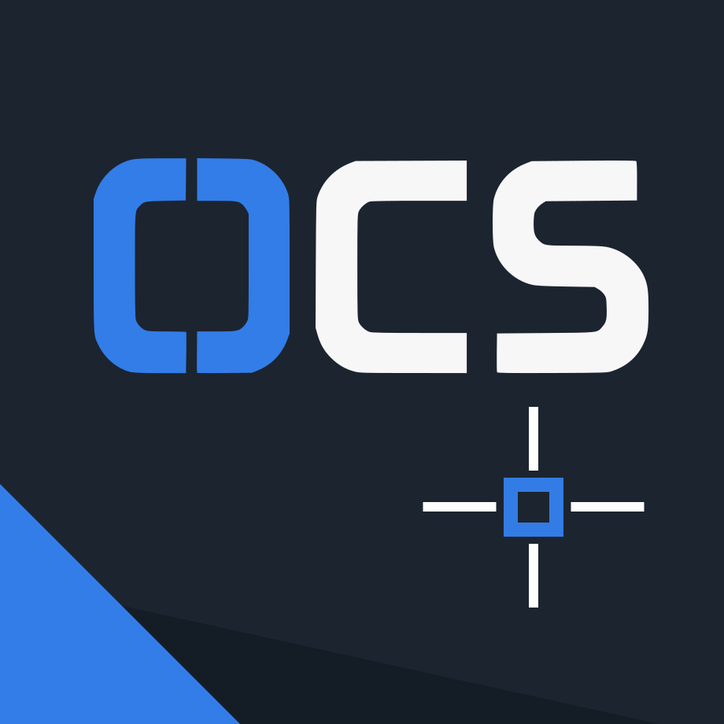
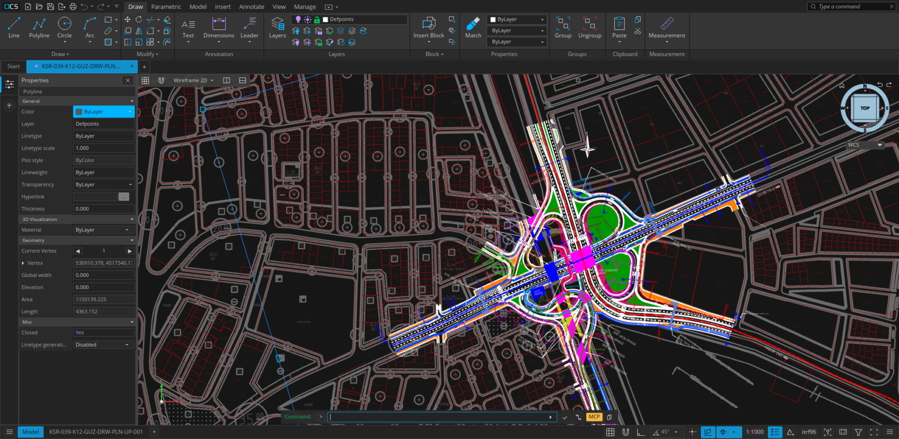
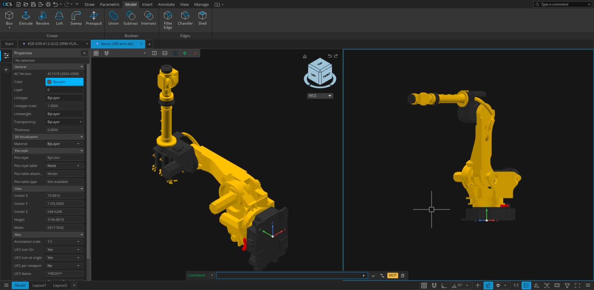

<p align="center">
  <a href="../../README.md">English</a> ·
  <a href="README.bg.md">Български</a> ·
  <a href="README.pt-BR.md">Português (Brasil)</a> ·
  <a href="README.cs.md">Čeština</a> ·
  <a href="README.nl.md">Nederlands</a> ·
  <a href="README.fr.md">Français</a> ·
  <a href="README.fi.md">Suomi</a> ·
  <a href="README.de.md">Deutsch</a> ·
  <a href="README.el.md">Ελληνικά</a> ·
  <a href="README.hu.md">Magyar</a> ·
  <a href="README.it.md">Italiano</a> ·
  <a href="README.ja.md">日本語</a> ·
  <a href="README.ko.md">한국어</a> ·
  <a href="README.lo.md">ລາວ</a> ·
  <a href="README.pl.md">Polski</a> ·
  <a href="README.ru.md">Русский</a> ·
  <a href="README.zh-CN.md">简体中文</a> ·
  <a href="README.es.md">Español</a> ·
  <a href="README.zh-TW.md">繁體中文</a> ·
  <a href="README.tr.md">Türkçe</a> ·
  <a href="README.hi.md">हिन्दी</a> ·
  <a href="README.ar.md">العربية</a> ·
  <a href="README.uz.md">Özbekça</a>
</p>

<p align="center">
  
</p>

<h1 align="center">Open CAD Studio</h1>

<p align="center">
  Rust tilida yaratilgan, kompyuter va veb uçun oçiq kodli 2D çizmaçilik va 3D modellaştiriş dasturi.
</p>

<p align="center">
  <a href="https://github.com/HakanSeven12/OpenCADStudio/releases/latest"></a>
  <a href="https://github.com/HakanSeven12/OpenCADStudio/releases"></a>
  <a href="https://github.com/HakanSeven12/OpenCADStudio/stargazers"></a>
  <a href="../../LICENSE"></a>
</p>

<p align="center">
  <a href="https://www.opencadstudio.com"><strong>Veb-ilovani oçiş</strong></a>
  ·
  <a href="https://github.com/HakanSeven12/OpenCADStudio/releases/latest"><strong>Kompyuter ilovasini yuklab oliş</strong></a>
  ·
  <a href="https://github.com/HakanSeven12/OpenCADStudio/discussions"><strong>Muhokamaga qöşiliş</strong></a>
</p>

<p align="center">
  
</p>

## Umumiy ma’lumot

Open CAD Studio — texnik çizmaçilik, maket tuziş va qattiq jismli modellaştiriş uçun kross-platforma dastur. U DWG va DXF çizmalarini töğridan-töğri öqiydi hamda yozadi; kompyuter va brauzer versiyalari bitta umumiy tahrirlaş yadrosidan foydalanadi.

Loyiha faol işlab çiqiş bosqiçida. Muhim işlab çiqariş çizmalarining zaxira nusxalarini saqlang va takrorlanadigan muammolar haqida [GitHub Issues](https://github.com/HakanSeven12/OpenCADStudio/issues) orqali xabar bering.

## Asosiy imkoniyatlar

- **Töğridan-töğri çizma iş jarayoni** — DWG va DXF fayllarini konvertatsiya xizmatisiz oçing, tahrirlang, tiklang va saqlang.
- **Aniq 2D çizmaçilik** — çiziqlar, poliçiziqlar, egrilar, splaynlar, ştrixovkalar, obyektga boğlaş, kuzatiş, qatlamlar, bloklar va taşqi havolalar.
- **Hujjatlaştiriş vositalari** — matn, ölçamlar, çiqaruv çiziqlari, dopusklar, jadvallar, model fazosi, qoğoz fazosi, köriniş oynalari va çop etiş uslublari.
- **Yadroga asoslangan 3D modellaştiriş** — qattiq jism primitivlari, çiqariq (extrude), aylantiriş (revolve), suriş (sweep), loft, Bul amallari va ACIS obyektlari tesselyatsiyasi.
- **GPU renderlaş** — `wgpu` orqali tezlaştirilgan 2D va 3D köriniş oynalari, ortografik va perspektiv kameralar.
- **Kengaytiriluvçan iş jarayonlari** — mahalliy plaginlar, buyruq skriptlari, interfeyssiz konvertatsiya va satrga asoslangan JSON avtomatlaştiriş API si.

<p align="center">
  
</p>

## Fayllar bilan işlaş

| Format yoki iş jarayoni | Qöllab-quvvatlaş |
| --- | --- |
| DWG | Öqiş va yoziş; R14 dan 2018 gaça bölgan versiyalarda saqlaş |
| DXF | Öqiş va yoziş; R14 dan 2018 gaça bölgan versiyalarda saqlaş |
| BAK / SV$ | Çizma zaxira nusxalari va avtosaqlaş fayllarini oçiş |
| OBJ | Köpburçakli törlarni import qiliş |
| SVG / SVGZ | Vektor şakllarni blok sifatida import qiliş (`SVGIN` yoki `IMPORT`) |
| LandXML | `CgPoint` geodezik nuqtalarini import qiliş |
| STL | 3D tör ma’lumotlarini eksport qiliş |
| STEP AP203 / AP214 / AP242 | B-rep qattiq jismlarni import qiliş; qattiq jismlarni aniq B-rep sifatida eksport qiliş |
| PDF | Kompyuterda maketlar va tanlangan geometriyani çop etiş |
| CSV | Obyekt xususiyatlari ma’lumotlarini ajratib oliş |
| CTB / STB | Çop etiş uslubi jadvallarini yuklaş va tahrirlaş |

## Kompyuter yoki veb

Örnatişsiz darhol işlaş uçun [veb-ilovadan](https://www.opencadstudio.com) foydalaning. Çizmalar brauzer orqali tanlanadi va mahalliy yuklab oliş sifatida saqlanadi.

Tizim fayl boğlanmalari, fayl menejeri miniatyuralari, tizim printeri orqali çop etiş, PDF çiqariş, taşqi plaginlar, buyruq skriptlari va interfeyssiz avtomatlaştiriş uçun kompyuter ilovasidan foydalaning. Tayyor relizlar Windows, Linux va Apple Silicon macOS uçun mavjud.

## Örnatiş

Kompyuteringiz uçun paketni [yuklab oliş sahifasidan](https://www.opencadstudio.com/download/) yuklab oling; u yerdagi har bir havola eng sönggi relizga olib boradi. Barça fayllar [eng sönggi reliz](https://github.com/HakanSeven12/OpenCADStudio/releases/latest) sahifasida ham mavjud.

### Windows

Imzolangan paketlardan birini tanlang (`x86_64` — Intel va AMD protsessorlari uçun, `arm64` — ARM protsessorlari uçun):

- `OpenCADStudio-*-windows-x86_64-installer.msi` / `…-windows-arm64-installer.msi` — Start menyusi yorliqlari, DWG/DXF fayl boğlanmalari va çizma miniatyuralarini öz içiga olgan tavsiya etilgan örnatuvçi.
- `OpenCADStudio-*-windows-x86_64-portable.exe` / `…-windows-arm64-portable.exe` — mustaqil ilova; örnatiş talab qilinmaydi.

Yoki Windows Package Manager orqali örnating:

```powershell
winget install HakanSeven.OpenCADStudio
```

### Linux

AppImage (`linux-x86_64` yoki ARM uçun `linux-aarch64`) faylini yuklab oling, uni bajariluvçi qiling va işga tuşiring:

```bash
chmod +x OpenCADStudio-*-linux-x86_64.AppImage
./OpenCADStudio-*-linux-x86_64.AppImage
```

Yoki uni [FlatPark](https://flatpark.org/apps/io.github.HakanSeven12.OpenCadStudio) orqali Flatpak sifatida örnating (rasmiy AppImage ni örnatadi va yangi relizlarni kuzatadi):

```bash
flatpak remote-add --if-not-exists flatpark https://dl.flatpark.org/flatpark.flatpakrepo
flatpak install flatpark io.github.HakanSeven12.OpenCadStudio
```

Flatpak çizmalarni fayl tanlovçi orqali oçadi va saqlaydi. Boşqa fayllarga körsatadigan taşqi havolalar va tagliklar uçun uy papkasiga kiriş ruxsati kerak:

```bash
flatpak override --user --filesystem=home io.github.HakanSeven12.OpenCadStudio
```

Har bir relizda snap paketi ham mavjud. U hali Snap Store da yöq, şuning uçun snapd uni faqat `--dangerous` bilan örnatadi va u özini avtomatik yangilamaydi:

```bash
sudo snap install --dangerous OpenCADStudio-*-linux-x86_64.snap
```

### macOS

Paketlar Apple Silicon va Intel Mac kompyuterlari uçun çiqariladi:

1. `OpenCADStudio-*-macos-arm64.dmg` (Apple Silicon) yoki `OpenCADStudio-*-macos-x86_64.dmg` (Intel) faylini yuklab oling.
2. Disk tasvirini oçing va `OpenCADStudio.app` ni **Applications** jildiga suring.
3. Agar Gatekeeper birinçi işga tuşirişni bloklasa, **System Settings → Privacy & Security** bölimidan ilovaga ruxsat bering.

Ilova ad-hoc tarzda imzolangan, ammo hozirça Apple tomonidan notarial tasdiqlanmagan.

## Tillar

Open CAD Studio tizim tiliga amal qilişi yoki quyidagi 24 ta interfeys tilidan istalgan birida işlaşi mumkin:

> Arab · Bolgar · Çex · Fin · Fransuz · Golland · Grek · Hind · Ingliz · Ispan · Italyan · Koreys · Laos · Nemis · Özbek · Polyak · Portugal (Braziliya) · Rus · Soddalaştirilgan Xitoy · An’anaviy Xitoy · Turk · Venger · Vyetnam · Yapon

Tilni dastur sozlamalaridan özgartiring. Brauzer versiyasi ham **Tizim** tanlanganda brauzerning afzal körilgan tilidan foydalanadi.

## Manba koddan yiğiş

### Kompyuter

Talablar:

- Git
- Joriy barqaror Rust asboblar töplami (toolchain)
- Platforma grafikasi va şrift işlab çiqiş kutubxonalari

Ubuntu yoki Debian da mahalliy boğliqliklarni quyidagiça örnating:

```bash
sudo apt update
sudo apt install libgl1-mesa-dev libx11-dev libxcursor-dev libxi-dev \
  libxrandr-dev libxkbcommon-dev libwayland-dev libfontconfig1-dev \
  libfreetype6-dev
```

Söngra yiğing va işga tuşiring:

```bash
git clone https://github.com/HakanSeven12/OpenCADStudio.git
cd OpenCADStudio
cargo build --release --bin OpenCADStudio
```

Tayyor binar fayl `target/release/OpenCADStudio` (Windows da `OpenCADStudio.exe`) manziliga yoziladi.

### Veb

WebAssembly maqsadi va yiğiş vositalarini bir marta örnating:

```bash
rustup target add wasm32-unknown-unknown
cargo install trunk wasm-bindgen-cli
```

Işlab çiqiş serverini işga tuşiring:

```bash
trunk serve
```

## Avtomatlaştiriş

Kompyuter binar fayli bir martalik konvertatsiyani, doimiy interfeyssiz serverni va AI ilovalari uçun mijozdan mustaqil MCP nuqtasini qöllab-quvvatlaydi:

```bash
OpenCADStudio --export input.dwg output.dxf
OpenCADStudio --export input-r12.dxf output.dwg --target-version R14
OpenCADStudio --serve
OpenCADStudio --serve --port 4242
OpenCADStudio --mcp
```

Avtomatlaştiriş serveri standart kiritiş/çiqariş yoki mahalliy TCP soketi orqali har satrda bitta JSON obyekti almaşadi. Mustaqil MCP nuqtasi jonli kompyuter muharririni ayni vositalar orqali har qanday mos mijozga taqdim etadi. Uning `audit` va `save_verified` amallari aniq DWG/DXF maqsadli versiyasini, yöqotişli yozuvlarni va xom DXF tutqiç havolalarini tekşiradi, natijani qayta oçadi, semantik manifestni taqqoslaydi va SHA-256 xeşini qaytaradi. Mijozni ulaş uçun uni `OpenCADStudio --mcp` ni işga tuşiradigan qilib sozlang. Batafsil ma’lumot uçun [MCP boşqaruv qöllanmasiga](../../docs/automation/README.md) qarang.

## Plaginlar

Kompyuter plaginlari alohida jarayonlarda işlaydi va asosiy dastur bilan versiyalangan plagin API si orqali boğlanadi. Brauzer versiyasi mahalliy plaginlarni yuklamaydi.

- [Plagin arxitekturasi](../../docs/plugin-architecture.md)
- [Plagin şabloni](../../docs/plugin-template/README.md)
- [Plaginlar reyestri](../../plugins/README.md)

## Loyiha hujjatlari

- [Avtomatlaştiriş API](../../docs/automation/README.md)
- [Plagin arxitekturasi](../../docs/plugin-architecture.md)
- [Tesselyatsiya konveyeri](../../docs/tessellation.md)
- [Xavfsizlik siyosati](../../SECURITY.md)

## Hissa qöşiş

Xato hisobotlari, maqsadli pull request lar, tarjimalar, hujjatlarni yaxşilaş va plagin hissalarini mamnuniyat bilan qabul qilamiz.

- Yangi hisobot oçişdan oldin mavjud [muammolarni (issues)](https://github.com/HakanSeven12/OpenCADStudio/issues) qidiring.
- Savollar va ğoyalar uçun [Muhokamalardan (Discussions)](https://github.com/HakanSeven12/OpenCADStudio/discussions) foydalaning.
- Zaifliklar haqida [xavfsizlik siyosatiga](../../SECURITY.md) muvofiq maxfiy tarzda xabar bering.

Ilova tarjimalari `locales/*/opencadstudio.ftl` fayllarida saqlanadi; manba yorliqlari `src/locale_catalog.rs` orqali boğlanadi. Tarjimalarni tahrirlagandan söng veb va kompyuter qadoqlaş yorliqlarini yangilaş uçun `python3 scripts/export-locales.py` ni işga tuşiring. `python3 scripts/test_site.py` va `cargo test --lib i18n::tests` bilan tekşiring.

## Loyiha ösişi

### Yulduzçalar

<a href="https://github.com/HakanSeven12/OpenCADStudio/stargazers">
  <picture>
    <source media="(prefers-color-scheme: dark)" srcset="https://www.opencadstudio.com/star-history-dark.svg">
    <source media="(prefers-color-scheme: light)" srcset="https://www.opencadstudio.com/star-history-light.svg">
    
  </picture>
</a>

### Reliz yuklab olişlari

<a href="https://github.com/HakanSeven12/OpenCADStudio/releases">
  <picture>
    <source media="(prefers-color-scheme: dark)" srcset="https://www.opencadstudio.com/download-history-dark.svg">
    <source media="(prefers-color-scheme: light)" srcset="https://www.opencadstudio.com/download-history-light.svg">
    
  </picture>
</a>

## Loyihani qöllab-quvvatlaş

Agar Open CAD Studio işingizda yordam bersa, [GitHub Sponsors](https://github.com/sponsors/HakanSeven12) yoki [Patreon](https://www.patreon.com/HakanSeven12) orqali loyiha rivojini qöllab-quvvatlang.

## Litsenziya

Open CAD Studio [GNU General Public License v3.0](../../LICENSE) litsenziyasi ostida tarqatiladi.
